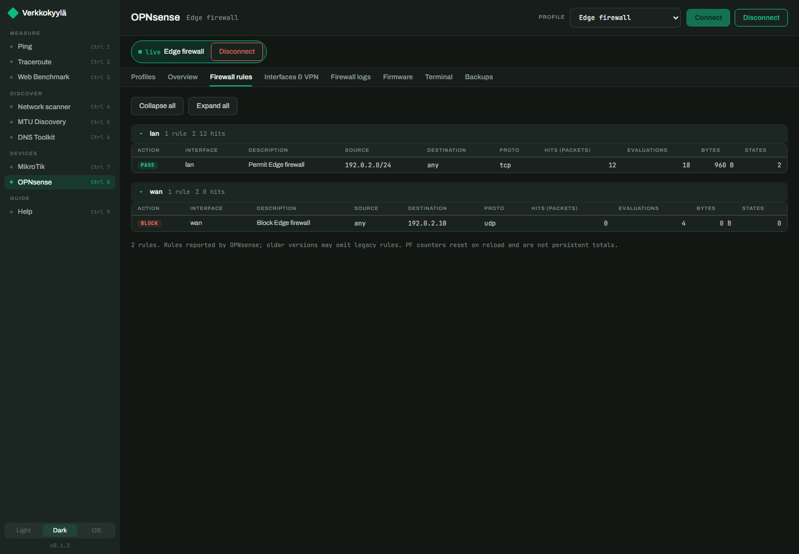
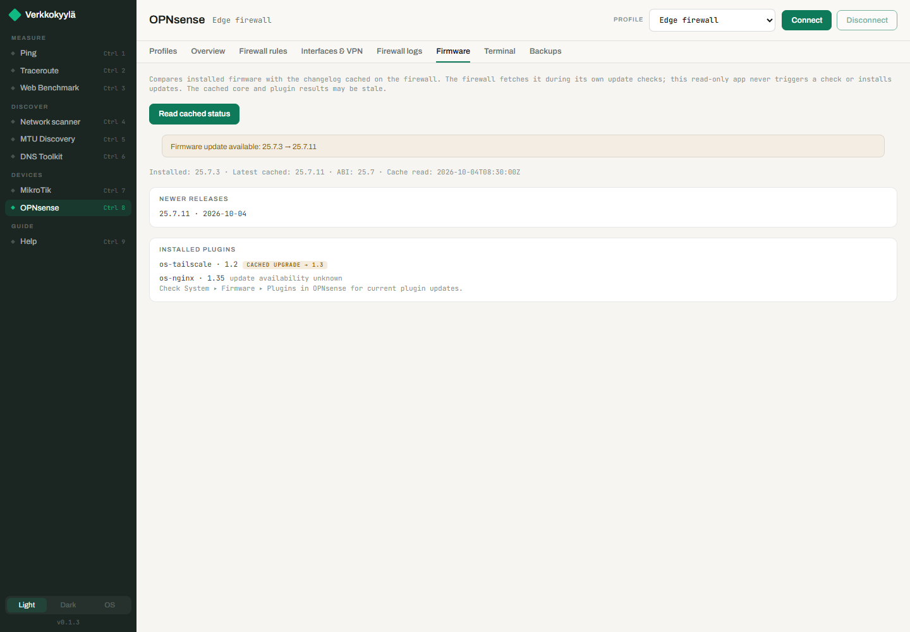
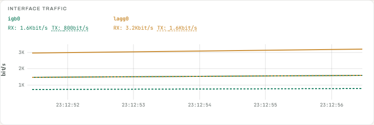
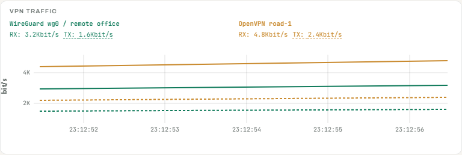

# Verkkokyylä

[](https://github.com/tero-k/verkkokyyla/actions/workflows/ci.yml)
[](https://github.com/tero-k/verkkokyyla/releases)
[](LICENSE)

A desktop network toolbox for Windows, macOS, and Linux (Tauri 2). It bundles
the everyday network tools (ping, traceroute, a web download benchmark, a LAN
scanner, MTU discovery, and DNS diagnostics) with MikroTik router and OPNsense
firewall management: multi-device live monitoring, log streaming, interactive
SSH terminals, and encrypted backup downloads.

Measurement history is kept in local SQLite for reopening later.
MikroTik passwords and OPNsense API credentials live in the operating
system keyring, never in the database. An in-app **Help** view (sidebar or
`Ctrl 9`) explains each tool.

> The name is Finnish: *verkko* (network) + *kyylä* (someone who snoops
> around).


## Download

Grab the latest installer from
[GitHub Releases](https://github.com/tero-k/verkkokyyla/releases): Windows
(NSIS/MSI installer, or the standalone exe zip; it needs the WebView2
runtime, preinstalled on up-to-date Windows 10/11), macOS (dmg, or the raw
`.app` tarball, signed and notarized), and Linux (deb/rpm, or the portable
AppImage). Or build from source; see [Development](#development).

On startup the app can show a notice when a newer stable release exists; the
notice links to the Releases page and never downloads or installs anything on
its own. It can be turned off under Help → Updates.

## Screenshots

| | |
|---|---|
|  |  |
|  |  |
|  |  |
|  |  |

## Tools

- **Ping / ICMP**: live latency table and graph with reopenable session
  history. The engine is chosen automatically per platform.
- **Traceroute**: the OS-native traceroute with hops streaming in live, kept
  in history like ping sessions.
- **Web Benchmark**: three modes against a URL. **Download** fetches a
  single file with live progress and final stats; **Page load** fetches a
  full page with its resources and shows a per-request waterfall;
  **Throughput** runs a repeatable detailed benchmark. HTTP settings
  (protocol version, timeouts, redirects, compression) are adjustable.
- **Network scanner**: discovers hosts on the local network. Pick the
  interface and subnet to scan; an optional TCP fallback complements ARP for
  hosts that don't answer it. A top-25 TCP port probe is available behind an
  explicit consent warning, results can be saved, and **Export CSV** writes
  through the native save dialog.
- **MTU Discovery**: finds the path MTU with Don't-Fragment ICMP probes
  (bracketing steps, then binary search) and falls back to TCP PLPMTUD probing
  on Linux when ICMP is filtered.
- **DNS Toolkit**: five tabs. **Lookup** queries A/AAAA/MX/NS/SOA/TXT records
  against a chosen resolver; **Benchmark** races resolvers with Quick, Stress,
  and Cache-bust presets; **Diagnostics** builds an evidence chain for pinning
  down where resolution breaks; **Email** checks SPF, DMARC, and DKIM (with
  custom selectors); **History** reopens saved runs.
- **MikroTik**: see below.
- **OPNsense**: read-only rule counters and search, firewall logs,
  interfaces/VPN with live traffic charts, firmware and cached plugin
  updates, saved-revision backups, SSH terminal.

Navigation: sidebar groups (Measure / Discover / Devices / Guide) with
`Ctrl 1`–`Ctrl 9` shortcuts; Light/Dark/OS theme switcher at the bottom.

## MikroTik

- **Profiles & credentials**: one profile per router (host, REST port,
  username). The password is stored in the OS keyring; the app database keeps
  only connection metadata. On Linux the keyring needs a running DBus Secret
  Service (for example gnome-keyring or KWallet); without one, credential
  storage is unavailable.
- **Monitoring**: connect a profile for live resources, interface rates,
  VLANs, and version/firmware status. Devices run independently: one session
  per device, up to eight concurrent. Monitoring keeps collecting while you
  use other tools, and stopped sessions are saved to history.
- **Logs**: per-device live log stream with severity highlighting and text
  filtering; streams also keep running in the background.
- **Terminal**: interactive SSH shell, one per device. Shells survive device
  and tool switching with scrollback intact. A colored identity tag on each
  terminal (mirrored by a `term` pill on the device chip) shows which
  router the shell drives, and switching between open terminals raises a
  warning that names the connection (silenceable for the session).
- **Backups**: the app asks RouterOS to create a backup file, downloads it
  over SFTP, and removes the temporary file. The last-used destination folder
  is remembered across restarts. Backups with the `.rsc` export can be
  compared in the library: select two to see a line-by-line config diff.

**Requirements:** RouterOS v7.1 or newer with the `www-ssl` service enabled
for HTTPS REST API access; plain HTTP is supported on v7.9+ with `www`. The
router's SSH service must be enabled for terminals and backups.

**Accepted risk:** for typical LAN-managed routers, the app accepts unknown
SSH host keys on first connection instead of requiring a pre-seeded
known-hosts entry.

## OPNsense

- **Profiles & credentials**: one profile per firewall. Enter the host as a
  DNS name or IP without a scheme, the HTTPS port, and a separately
  configurable SSH port for the terminal. Access uses a read-only API
  key/secret pair stored as a single OS keyring entry; the app database keeps
  only connection metadata, and the app only ever sends GET requests.
  **Test connection** on a profile separates "the firewall is reachable" from
  "the API key is authorized" before you commit to monitoring. Accepting
  self-signed certificates is an explicit per-profile option, not the
  default.
- **Monitoring**: pick a profile and press **Connect** — each connected
  firewall appears as a chip in the device strip and can be disconnected
  independently. **Overview** shows system resources and PF state-table
  usage. If a section refresh fails, the last good data is kept and marked
  stale rather than zeroed, and lists are marked incomplete when OPNsense
  ignores GET pagination instead of silently implying complete results.
- **Firewall rules**: hit counters use the firewall's interface identifiers,
  display names, and order, including **Floating / all interfaces**.
  **Search all rules** case-insensitively filters every group and visible
  rule field, with matching counts and explicit empty-result feedback.
- **Interfaces, VPN & traffic**: link aggregation (LAGG) plus WireGuard,
  OpenVPN, and IPsec tunnels and the Tailscale plugin when installed. Graph
  toggles on interfaces, WireGuard peers, and OpenVPN sessions add multiple
  RX/TX bit/s traces to the **Interface traffic** and **VPN traffic** panels.
  **Disabled/Enabled** describes local graph selection only; it never changes
  firewall configuration. Each connected firewall has an independent in-memory
  history of up to 720 samples (about one hour at the normal five-second
  refresh), cleared by disconnect/reconnect. Legends show `—` rather than a
  stale rate when fresh counters are unavailable.
- **Firewall logs**: a live log stream with its own connect/disconnect,
  filterable by All/Allowed/Blocked and free text. Only traffic matched by
  rules with logging enabled appears.
- **Firmware & plugins**: the firmware card compares the installed version
  with the firewall's cached release changelog — the app never starts an
  update check on the firewall, so a missing or stale cache cannot prove
  current availability. Installed plugins show cached upgrade targets when
  available; verify them in the OPNsense GUI.
- **Backups**: download any saved configuration revision. Choose a
  destination directory, pick the revision, and enter a strong passphrase;
  the file is encrypted locally as `*.xml.age` before it touches disk and the
  plaintext is never persisted. Restore with
  `age -d -o config.xml <file>.xml.age`, then import in the OPNsense GUI.
- **Terminal**: an interactive SSH shell with its own login, entirely
  separate from the read-only HTTP API — a dedicated OPNsense user and
  password authenticate SSH, never the API key. The first connection shows
  the firewall's SHA-256 host-key fingerprint and requires explicit
  verification; the verified key is pinned and a changed key is rejected
  until you deliberately forget the pin.

**Requirements:** OPNsense with an API key (System → Access → Users → API
keys). Read-only privileges are sufficient for every feature; the SSH service
must be enabled for the terminal.

## Development

Requires [Rust](https://rustup.rs/) and [Node.js](https://nodejs.org/).

```bash
npm install
```

## Tests

```bash
# Rust unit + integration tests
cargo test --manifest-path src-tauri/Cargo.toml

# Rust E2E tests that hit real network adapters (requires admin/root on Windows)
cargo test --manifest-path src-tauri/Cargo.toml -- --ignored e2e

# Frontend unit tests
npx vitest run

# UI E2E tests with Playwright (uses a Tauri mock)
npx playwright test
```

## Running

```bash
# Vite dev server + Tauri in dev mode
npm run tauri -- dev

# Production build (standalone exe + NSIS/MSI installers)
npm run tauri -- build
```

## Project layout

- `src-tauri/src/`: Rust backend with session managers, ping engines, MikroTik
  monitoring/logs/terminal/backup managers, stats, SQLite persistence.
- `src/`: React + TypeScript frontend with views per tool, live graphs, session
  history, in-app Help.
- `e2e/`: Playwright E2E tests with an in-browser Tauri mock.
- `src-tauri/tests/`: Rust integration tests against the real backend.

## Notes

- On Windows the app tries the `surge-ping` engine first and falls back to
  `winicmp`; on POSIX it tries `surge-ping` first and falls back to `osping`.
- The live ping table caps visible rows at 500; the graph can show the full
  session.

## Contributing

Contributions are welcome; see [CONTRIBUTING.md](CONTRIBUTING.md) for the dev
setup, test commands, and commit conventions. Please report security issues
privately per [SECURITY.md](SECURITY.md). Notable changes are tracked in
[CHANGELOG.md](CHANGELOG.md).

## License

[MIT](LICENSE) © Tero Kiminki
